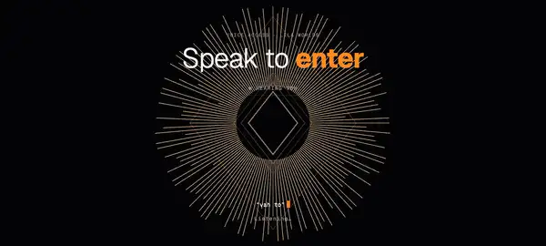

<h1 align="center">Lila Worlds</h1>
<p align="center">Studio site for <b>Lila Worlds</b>, a Bengaluru team building playable worlds, live in-game shows and VR for Fortnite, Roblox and Meta Quest.</p>
<p align="center"><a href="https://lila-worlds.vercel.app"></a></p>

<a href="https://lila-worlds.vercel.app"></a>

## Speak to enter
The site opens behind a **voice gate**. Allow the microphone and say **"Initialize Lila"** to get in, while a live audio visualiser reacts to your voice. It uses the browser's Web Speech API, so Chrome or Edge work best.

## Inside
**News · Worlds · Vision · Service** (Fortnite Creative / UEFN, Roblox experiences, Unreal Engine & VR) · **Lila Kit**

## Built with
GSAP · Lenis · Canvas · Web Speech API · Web Audio. Plain HTML, CSS and JS modules.

`tools/render-clips.cjs` renders `tools/clips.html` frame by frame into looping MP4s (needs Puppeteer and ffmpeg).

## Run it locally
```bash
python3 -m http.server 8000   # then open http://localhost:8000
```

<p align="center"><sub>Built by <a href="https://github.com/Amritanshu-nirjhar">Amritanshu Nirjhar</a> · more at the <a href="https://amritanshu-portfolio-beryl.vercel.app">portfolio ↗</a></sub></p>
